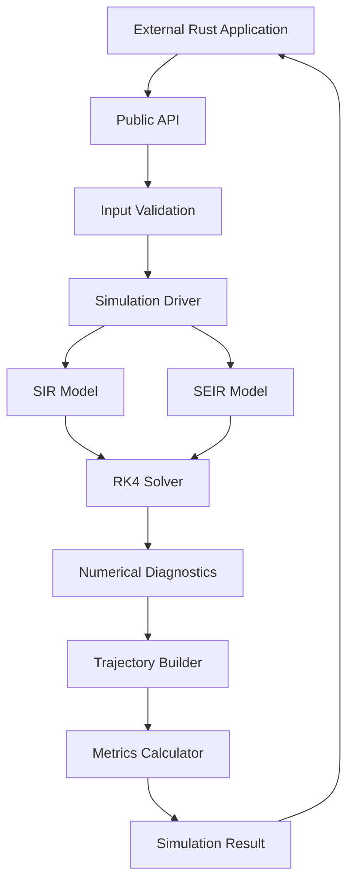

# EPISIM-CORE
## Technical Specification

**Document:** TECHNICAL_SPEC.md  
**Version:** 0.2  
**Status:** Approved and implemented; kept in step with the code on `master` (revised November 13, 2026)  
**Product:** EPISIM-CORE  
**Language:** Rust  
**Edition:** 2024  
**Minimum Supported Rust Version:** 1.85  
**Target Release:** v0.1.0  
**Architecture:** Pure Rust Library

**Revision note (0.2).** This specification was written before implementation. Revision 0.2 brings it in line with the code: the manifest, project structure, settings, solver signature, simulation pipeline, error variants, tests, quality pipeline, decisions register and resolved questions. Sections already updated by later changes (the recording interval, the stability limit, the step-error estimate and the threshold quantities) are unchanged. Where a section still describes the original proposal, it says so.

---

# 1. Technical Overview

## 1.1 Purpose

This document defines the technical architecture, module responsibilities, public API, mathematical implementation, numerical integration strategy, data structures, error handling, and testing requirements of EPISIM-CORE.

EPISIM-CORE will be implemented as an independent Rust library providing deterministic epidemiological compartmental simulations.

The first release supports:

- SIR compartmental model.
- SEIR compartmental model.
- Classical fourth-order Runge-Kutta numerical integration.
- Fixed-step simulation, with timesteps beyond the RK4 stability limit rejected (Section 6.3).
- An optional recording interval (Section 6.1).
- Epidemiological metrics, including threshold quantities (Sections 10.5 and 10.6).
- Structured simulation results.
- Numerical validation and diagnostics, and an estimate of the error the timestep introduces (Section 12.5).

The architecture must keep epidemiological equations, numerical integration, simulation orchestration, and result analysis logically separated.

## 1.2 Technical Objectives

1. Implement mathematically correct SIR and SEIR systems.
2. Provide a predictable and idiomatic Rust API.
3. Use a shared internal numerical integration implementation.
4. Maintain population conservation within documented numerical tolerance.
5. Detect numerical instability and invalid simulation states.
6. Minimize mandatory runtime dependencies.
7. Make the core engine reusable by downstream applications.

## 1.3 Non-Goals

The following are excluded from v0.1.0:

- GUI and desktop interfaces.
- CLI.
- HTTP or REST API.
- Database storage.
- Serialization and file export.
- Stochastic simulations.
- Agent-based modeling.
- Spatial epidemiology.
- Adaptive numerical integration.
- User-defined model plugins.
- Parallel execution.

---

# 2. Technology Stack

| Component | Technology | Responsibility |
|---|---|---|
| Programming language | Rust | Entire computational engine |
| Language edition | Rust 2024 | Language and compiler configuration |
| Build system | Cargo | Dependency and package management |
| Numerical precision | f64 | Floating-point calculations |
| Numerical solver | Internal RK4 | ODE integration |
| Error handling | Standard Rust | Typed errors and Result |
| Testing | Built-in test framework | Unit and integration testing |
| Benchmarking | Criterion | Performance measurement |
| Documentation | Rustdoc | Public API documentation |
| Version control | Git | Source management |

### 2.1 Cargo Configuration

The manifest as implemented:

```toml
[package]
name = "episim-core"
version = "0.1.0"
edition = "2024"
rust-version = "1.85"
description = "A lightweight epidemiological simulation engine"
readme = "README.md"
license = "MIT"
keywords = ["epidemiology", "simulation", "sir", "seir", "ode"]
categories = ["science", "simulation", "mathematics"]
include = [
    "/src/**/*.rs",
    "/tests/**/*.rs",
    "/examples/**/*.rs",
    "/benches/**/*.rs",
    "/docs/**/*.md",
    "/README.md",
    "/CHANGELOG.md",
    "/LICENSE",
]

[dev-dependencies]
criterion = { version = "0.7.0", default-features = false, features = ["cargo_bench_support"] }
```

The `include` list keeps the planning documents, `design/` and `plans/` out of the published package. There is deliberately no `repository` field yet.

The library must not require external dependencies for its core functionality.

Criterion is a development-only dependency for benchmarks.

### 2.2 Code Quality Requirements

The crate root must enforce:

```rust
#![forbid(unsafe_code)]
#![warn(missing_docs)]
#![deny(missing_debug_implementations)]
```

All public structures, functions, fields, and error variants must have Rustdoc documentation.

---

# 3. System Architecture

## 3.1 Architectural Pattern

EPISIM-CORE uses a layered computational architecture.

The public API exposes model-specific simulation functions. Internally, all models share the numerical solver, validation utilities, simulation driver, and result processing.

The implementation must not require users to understand the internal architecture to execute a simulation.

## 3.2 Architecture Diagram



## 3.3 Layer Responsibilities

### Layer 1: Public API

Provides the functions and data structures accessible to library users.

Responsibilities:

- Accept simulation configurations.
- Expose model-specific parameters.
- Expose initial population states.
- Return structured simulation results.
- Return typed errors.

### Layer 2: Validation

Checks all user-provided configuration values before simulation begins.

Responsibilities:

- Validate epidemiological parameters.
- Validate initial population states.
- Validate simulation duration.
- Validate timestep.
- Validate maximum simulation steps.

### Layer 3: Model

Contains the mathematical definitions of epidemiological models.

Responsibilities:

- Calculate compartment derivatives.
- Define compartment ordering.
- Provide model-specific parameter validation.
- Provide model-specific state conversion.

The model layer must not manage memory allocation for trajectories or expose application-level functionality.

### Layer 4: Numerical Solver

Contains the implementation of classical RK4.

Responsibilities:

- Calculate intermediate slopes.
- Produce the next numerical state.
- Support fixed timesteps.
- Handle the final partial timestep.
- Detect non-finite intermediate calculations.

The solver must remain independent of SIR and SEIR-specific public structures.

### Layer 5: Simulation Driver

Coordinates model execution.

Responsibilities:

- Initialize simulation state.
- Execute numerical integration.
- Record observations.
- Enforce maximum-step limits.
- Check population conservation.
- Detect invalid compartment values.

### Layer 6: Results and Metrics

Transforms the completed trajectory into structured output.

Responsibilities:

- Calculate peak infectious population.
- Calculate peak infectious time.
- Calculate basic reproduction number.
- Calculate cumulative infections.
- Calculate cumulative incidence fraction.
- Return numerical diagnostics.

---

# 4. Project Structure

The source structure as implemented:

```text
episim-core/
│
├── Cargo.toml
├── Cargo.lock
├── README.md
├── LICENSE
├── CHANGELOG.md
├── .github/workflows/ci.yml
│
├── src/
│   ├── lib.rs
│   ├── error.rs
│   ├── validation.rs
│   ├── settings.rs
│   ├── result.rs
│   ├── metrics.rs
│   ├── accuracy.rs
│   │
│   ├── models/
│   │   ├── mod.rs
│   │   ├── sir.rs
│   │   ├── seir.rs
│   │   ├── sis.rs
│   │   ├── sirs.rs
│   │   └── seirs.rs
│   │
│   ├── solver/
│   │   ├── mod.rs
│   │   └── rk4.rs
│   │
│   └── simulation/
│       ├── mod.rs
│       └── driver.rs
│
├── tests/
│   ├── crate_smoke_test.rs
│   ├── sir_tests.rs
│   ├── seir_tests.rs
│   ├── sis_tests.rs
│   ├── sirs_tests.rs
│   ├── seirs_tests.rs
│   ├── validation_tests.rs
│   ├── numerical_tests.rs
│   ├── convergence_tests.rs
│   └── stability_evidence_tests.rs
│
├── examples/
│   ├── basic_sir.rs
│   ├── basic_seir.rs
│   ├── outbreak_curve.rs
│   └── r0_sweep.rs
│
├── benches/
│   └── simulation_bench.rs
│
├── docs/
│   ├── architecture.md
│   ├── mathematical_models.md
│   ├── numerical_methods.md
│   └── api_design.md
│
└── design/
    └── 007-waning-immunity-models.md
```

The unit tests of private code (solver, driver, validators, metric calculation) live in `#[cfg(test)]` modules next to that code, because integration tests cannot reach `pub(crate)` items.

## 4.1 Module Ownership

| Module | Responsibility |
|---|---|
| `lib.rs` | Public API and exports |
| `error.rs` | Error definitions |
| `validation.rs` | Input and parameter validation |
| `settings.rs` | Simulation configuration |
| `result.rs` | Result and observation structures |
| `metrics.rs` | Epidemiological metrics |
| `accuracy.rs` | Step-error estimate |
| `models/sir.rs` | SIR equations and model implementation |
| `models/seir.rs` | SEIR equations and model implementation |
| `models/sis.rs` | SIS equations and model implementation |
| `models/sirs.rs` | SIRS equations and model implementation |
| `models/seirs.rs` | SEIRS equations and model implementation |
| `solver/rk4.rs` | Numerical integration |
| `simulation/driver.rs` | Simulation orchestration |

Internal modules should remain private unless a deliberate public extension requirement appears.

---

# 5. Domain Model and Data Structures

## 5.1 Design Principles

All population quantities and epidemiological parameters use `f64`.

This is intentional because deterministic compartmental models represent continuous population quantities and expected counts rather than necessarily integer individuals.

All public numerical types must document their units.

All domain structures should derive appropriate standard traits:

```rust
#[derive(Debug, Clone, Copy, PartialEq)]
```

Structures containing owned trajectories should use `Clone` and `PartialEq` where appropriate, but not necessarily `Copy`.

## 5.2 SIR Parameters

```rust
pub struct SirParameters {
    pub beta_per_day: f64,
    pub gamma_per_day: f64,
}
```

Definitions:

- `beta_per_day`: transmission rate.
- `gamma_per_day`: recovery rate.

Validation:

- Beta must be finite and non-negative.
- Gamma must be finite and strictly positive.

## 5.3 SIR State

```rust
pub struct SirState {
    pub susceptible: f64,
    pub infected: f64,
    pub recovered: f64,
}
```

All values represent population counts.

Requirements:

- Every compartment must be finite.
- Every compartment must be non-negative.
- The sum must be finite and strictly positive.

## 5.4 SEIR Parameters

```rust
pub struct SeirParameters {
    pub beta_per_day: f64,
    pub sigma_per_day: f64,
    pub gamma_per_day: f64,
}
```

Additional parameter:

- `sigma_per_day`: rate of progression from exposed to infectious.

Validation:

- Beta must be finite and non-negative.
- Sigma must be finite and strictly positive.
- Gamma must be finite and strictly positive.

## 5.5 SEIR State

```rust
pub struct SeirState {
    pub susceptible: f64,
    pub exposed: f64,
    pub infected: f64,
    pub recovered: f64,
}
```

## 5.6 Population Size

The total population is calculated from the initial state.

SIR:

```rust
let population =
    initial_state.susceptible
    + initial_state.infected
    + initial_state.recovered;
```

SEIR:

```rust
let population =
    initial_state.susceptible
    + initial_state.exposed
    + initial_state.infected
    + initial_state.recovered;
```

The population size remains constant throughout the simulation.

It must not be recalculated as the simulation progresses because doing so could introduce unintended changes in the transmission formulation.

## 5.7 Waning-Immunity Models

These follow `design/007-waning-immunity-models.md`. Their equations are in `docs/mathematical_models.md`. Each has its own parameter type, and reuses a state type where the compartments are the same:

| Model | Parameters | State |
|---|---|---|
| SIS | `SisParameters { beta_per_day, gamma_per_day }` | `SisState { susceptible, infected }` |
| SIRS | `SirsParameters { beta_per_day, gamma_per_day, omega_per_day }` | `SirState` |
| SEIRS | `SeirsParameters { beta_per_day, sigma_per_day, gamma_per_day, omega_per_day }` | `SeirState` |

Validation is that of SIR (SEIR for SEIRS), plus `omega_per_day` finite and non-negative. The total population is the sum of the initial compartments.

---

# 6. Simulation Configuration

## 6.1 SimulationSettings

Public configuration, with private fields set through validated construction:

```rust
pub struct SimulationSettings {
    duration_days: f64,
    step_days: f64,
    max_steps: usize,
    record_every: usize,
}

impl SimulationSettings {
    pub fn new(duration_days: f64, step_days: f64) -> Result<Self, SimulationError>;
    pub fn with_max_steps(self, max_steps: usize) -> Result<Self, SimulationError>;
    pub fn with_record_every(self, steps: usize) -> Result<Self, SimulationError>;
    pub fn duration_days(&self) -> f64;
    pub fn step_days(&self) -> f64;
    pub fn max_steps(&self) -> usize;
    pub fn record_every(&self) -> usize;
}
```

Invalid settings therefore cannot reach the simulation driver.

Responsibilities:

- Define the total simulation duration.
- Define the fixed integration timestep.
- Prevent unexpectedly large simulation workloads.

### Validation

| Field | Condition |
|---|---|
| `duration_days` | Finite and greater than zero |
| `step_days` | Finite and greater than zero |
| `max_steps` | Greater than zero |
| `record_every` | Greater than zero |

### Maximum Step Limit

The default maximum is 1,000,000 integration steps.

Users may change the limit with `with_max_steps`.

This is an engineering safeguard, not an epidemiological restriction.

The engine must calculate the required number of steps before allocating the trajectory and reject configurations that exceed the configured maximum.

### Recording Interval

By default every accepted integration step is recorded. Users may configure a recording interval of N steps through a configuration method, after which only every N-th step is stored. The initial state and the final state are always recorded. An interval of zero must be rejected with `InvalidRecordInterval`.

The recording interval changes storage only. Every step is still integrated, validated, and counted in the diagnostics, and the maximum step limit still applies to integration steps. Peak metrics are read from recorded observations, so a longer interval makes them coarser.

## 6.2 Timestep Handling

The engine uses fixed timesteps, except for the final interval.

Example:

```text
Duration: 10 days
Timestep: 3 days

Step 0: 0 -> 3
Step 1: 3 -> 6
Step 2: 6 -> 9
Step 3: 9 -> 10
```

The final interval must be shortened rather than extending the simulation beyond its requested duration.

The final observation must have:

```rust
time_days == settings.duration_days
```

The implementation must detect cases where a timestep is too small to advance the floating-point simulation clock.

## 6.3 Timestep Stability Limit

Classical RK4 is only conditionally stable. For a quantity that should decay at rate `r`, one step of size `h` multiplies it by:

\[
1-z+\frac{z^2}{2}-\frac{z^3}{6}+\frac{z^4}{24},\qquad z=rh
\]

This factor is 1/3 at `z = 2`, rises steeply after it, and exceeds 1 once `z` is greater than about 2.785. Past that point the quantity grows when it should decay, while remaining positive and conserving the total population, so the per-step diagnostics in Section 12 cannot detect it.

The engine must reject a configuration, before integration begins, when the model's fastest decay rate multiplied by the step exceeds 2:

| Model | Fastest decay rate |
|---|---|
| SIR | `max(beta, gamma)` |
| SEIR | `max(beta, (sigma + gamma) / 2 + sqrt(((sigma - gamma) / 2)^2 + sigma * beta))` |
| SIS | `max(beta + gamma, 1.25 * gamma)` |
| SIRS | `max(beta + gamma, omega)` |
| SEIRS | `beta + sigma + gamma + omega` |

In SIS, `beta + gamma` is the decay rate of a small departure from the state with everyone infected, and the `1.25 * gamma` floor keeps the RK4 increment of the cumulative infections from turning negative, which it does above `gamma * h` of about 1.62. Susceptibles empty at up to beta per day. In SEIR the exposed and infected compartments feed each other (progression moves exposed to infected, transmission creates exposed from infected), so the pair decays faster than sigma or gamma alone. The second SEIR term is the fast eigenvalue of that pair in a fully susceptible population, where the coupling is strongest. Checking each rate separately is not sufficient: with beta = 1.0, sigma = 0.25, gamma = 2.78, and a step of one day, every single product is below 2.785, yet the run reports a peak of 370 infected where the correct peak is the initial 100.

The step compared with the limit is the step actually taken, `min(step_days, duration_days)`. A product exactly equal to 2 is accepted.

The error is `TimeStepTooLarge { max_step_days }`, where `max_step_days` is `2 / fastest rate`, the largest step accepted for the same parameters.

The limit of 2 is an engineering choice supported by measurement, not a derived bound. In randomised comparisons against fine-step runs, no run within the limit moved a compartment in the wrong direction or missed the final incidence by more than 0.1, while runs between about 2.2 and the stability boundary at 2.785 did. The limit and the SEIR rate should be revisited if a counterexample is found. The comparison is kept in the repository as the ignored test `tests/stability_evidence_tests.rs`.

This is a stability guard, not an accuracy guarantee. A timestep within the limit can still give inaccurate results, and the engine does not detect that.

---

# 7. Numerical Solver Design

## 7.1 Selected Method

The MVP uses the classical fourth-order Runge-Kutta method.

RK4 is selected because it provides fourth-order global accuracy for sufficiently smooth problems under appropriate stability conditions, while remaining relatively straightforward to implement and test.

Its expected global truncation error behaves as:

\[
E(h)=O(h^4)
\]

This means that, in the asymptotic convergence region, halving the timestep should reduce the leading global error by approximately a factor of 16.

The actual observed ratio may differ due to floating-point error and the specific simulation scenario.

## 7.2 RK4 Algorithm

For:

\[
\frac{dy}{dt}=f(y)
\]

The solver calculates four intermediate slopes:

\[
k_1=f(y_n)
\]

\[
k_2=f(y_n+\frac{h}{2}k_1)
\]

\[
k_3=f(y_n+\frac{h}{2}k_2)
\]

\[
k_4=f(y_n+hk_3)
\]

The next state is:

\[
y_{n+1}=y_n+\frac{h}{6}(k_1+2k_2+2k_3+k_4)
\]

Here, `h` represents the current integration interval.

## 7.3 Internal Solver Interface

The solver must operate on fixed-size numerical arrays.

The implemented signature:

```rust
pub(crate) fn rk4_step<const N: usize, F>(
    state: [f64; N],
    step: f64,
    derivative: F,
) -> Result<[f64; N], SimulationError>
where
    F: Fn([f64; N]) -> [f64; N];
```

This is an internal function, not part of the public API. A non-finite step returns `InvalidTimeStep`. A non-finite stage input or slope returns `NonFiniteIntermediate { stage }` with stage `"k1"` to `"k4"`, and a non-finite combined result uses stage `"final"`.

The implementation should avoid heap allocations during individual integration steps.

The model layer converts its public state structures into fixed-size arrays before integration and converts the output array back into the relevant state type.

## 7.4 Solver Restrictions

The MVP does not implement:

- Adaptive timestep control.
- Error-controlled integration.
- Higher-order embedded methods.
- Implicit integration.
- Automatic positivity preservation.

The solver must not silently clip negative values to zero.

A materially negative compartment value must produce a numerical error.

Very small negative values within the documented floating-point roundoff tolerance may be accepted and counted in numerical diagnostics. They must not be silently modified.

Because the solver has no error control, a timestep beyond its stability limit must be rejected before integration. See Section 6.3.

---

# 8. Mathematical Model Implementation

## 8.1 SIR Derivative Function

The implementation follows:

\[
\frac{dS}{dt}=-\beta\frac{SI}{N}
\]

\[
\frac{dI}{dt}=\beta\frac{SI}{N}-\gamma I
\]

\[
\frac{dR}{dt}=\gamma I
\]

The internal implementation should calculate infection pressure using a numerically sensible evaluation order:

```rust
let infection_flow =
    beta_per_day * (susceptible / population) * infected;
```

This avoids an unnecessary intermediate multiplication of two large population values.

The derivative array is:

```rust
[
    -infection_flow,
    infection_flow - recovery_flow,
    recovery_flow,
]
```

Where:

```rust
let recovery_flow =
    gamma_per_day * infected;
```

## 8.2 SEIR Derivative Function

The equations are:

\[
\frac{dS}{dt}=-\beta\frac{SI}{N}
\]

\[
\frac{dE}{dt}=\beta\frac{SI}{N}-\sigma E
\]

\[
\frac{dI}{dt}=\sigma E-\gamma I
\]

\[
\frac{dR}{dt}=\gamma I
\]

Internal calculation:

```rust
let infection_flow =
    beta_per_day * (susceptible / population) * infected;

let progression_flow =
    sigma_per_day * exposed;

let recovery_flow =
    gamma_per_day * infected;
```

Derivative array:

```rust
[
    -infection_flow,
    infection_flow - progression_flow,
    progression_flow - recovery_flow,
    recovery_flow,
]
```

## 8.3 Important Mathematical Invariant

For every model, the derivatives of the compartments sum to zero:

\[
\sum_i \frac{dX_i}{dt}=0
\]

Therefore:

\[
N(t)=N(0)
\]

This invariant must be tested after every accepted integration step.

---

# 9. Simulation Execution Pipeline

The simulation driver must execute the following sequence:

1. Receive model parameters, initial state, and simulation settings.
2. Validate all input values, including the timestep stability limit.
3. Calculate initial population size.
4. Calculate the required integration step count.
5. Verify the configured maximum step limit.
6. Initialize the numerical trajectory.
7. Execute RK4 integration.
8. Validate each resulting state.
9. Check population conservation.
10. Record each observation.
11. Calculate epidemiological metrics.
12. Return a structured result.

As implemented, there is no model trait. Each public `simulate_*` function does steps 1 to 3 itself:

1. It validates its parameters and initial state.
2. It applies the stability limit and checks that `R0` is finite.
3. It calls the shared internal driver, `run_simulation` in `src/simulation/driver.rs`.

The driver receives the initial state as a fixed-size array whose last entry is the cumulative infection count `C` (Section 10.3). It also receives the fixed population, the settings, the derivative as a closure, a closure that converts an array back into the public state type, and the names of the compartments, used in errors. The per-state checks apply to the compartments only; `C` is recorded in each observation. The driver does steps 4 to 10. It counts the steps and enforces the limit before any allocation, then reserves the trajectory with a fallible reservation and integrates. Each accepted state is checked and recorded at the configured interval. The model function then calculates the metrics (step 11) and assembles the result (step 12).

Observation times are computed as `index * step_days`, with the last one set to the duration, rather than by repeated addition. The step count is `duration / step`, reduced by four ulps before rounding up, so that a duration that is a whole number of steps does not gain a step of rounding-error length.

The public model API remains concrete.

---

# 10. Public API Specification

## 10.1 API Design Principles

The public API must:

- Use descriptive names.
- Avoid unnecessary generic abstractions.
- Avoid exposing internal numerical implementation details.
- Return typed errors.
- Use standard Rust types.
- Document parameter units and assumptions.
- Avoid hidden global state.

The API follows established Rust library conventions for naming and public interfaces.

## 10.2 Proposed Public Functions

```rust
pub fn simulate_sir(
    parameters: SirParameters,
    initial_state: SirState,
    settings: SimulationSettings,
) -> Result<SimulationResult<SirState>, SimulationError>;
```

```rust
pub fn simulate_seir(
    parameters: SeirParameters,
    initial_state: SeirState,
    settings: SimulationSettings,
) -> Result<SimulationResult<SeirState>, SimulationError>;
```

Both functions must use the same internal solver infrastructure. The step-error estimates (Section 12.5) and the effective reproduction number (Section 10.6) complete the public functions.

## 10.3 Observation Structure

```rust
pub struct Observation<S> {
    pub time_days: f64,
    pub cumulative_infections: f64,
    pub state: S,
}
```

Each observation represents the model state at a particular simulation time.
`cumulative_infections` is the number of new infections since day zero. It
is integrated with the compartments as `dC/dt = beta * S * I / N`, is not a
compartment, and is excluded from the population conservation check.

## 10.4 Simulation Result

```rust
pub struct SimulationResult<S> {
    pub trajectory: Vec<Observation<S>>,
    pub metrics: EpidemicMetrics,
    pub diagnostics: SimulationDiagnostics,
}
```

The trajectory must contain:

- Initial observation at day zero.
- Every accepted integration step, or every N-th one when a recording interval is configured (Section 6.1).
- Final observation at the requested duration.

## 10.5 Epidemiological Metrics

```rust
#[non_exhaustive]
pub struct EpidemicMetrics {
    pub basic_reproduction_number: f64,
    pub herd_immunity_threshold: Option<f64>,
    pub peak_infectious: f64,
    pub peak_infectious_time_days: f64,
    pub cumulative_infections_since_start: f64,
    pub cumulative_incidence_fraction: f64,
    pub final_size_fraction: Option<f64>,
    pub endemic_prevalence: Option<f64>,
}
```

A metric that only some models define is an `Option`, `None` for the models
where it does not apply. `#[non_exhaustive]` lets later versions add metrics
without a breaking change.

Metric definitions:

### Basic reproduction number

For the MVP models:

\[
R_0=\frac{\beta}{\gamma}
\]

This describes the theoretical reproduction number when the population is fully susceptible under the model assumptions.

### Peak infectious population

\[
I_{\max}=\max_t I(t)
\]

This is calculated from recorded observations.

### Peak infectious time

The earliest recorded time at which the infectious population is within \(64\,\varepsilon\max(N_0, 1)\) of its recorded maximum, where \(\varepsilon\) is `f64::EPSILON`.

The tolerance matters where the infectious population levels off at its maximum: there roundoff alone would decide which observation is largest. Ties go to the earliest observation.

### Cumulative infections since simulation start

\[
\frac{dC}{dt}=\beta\frac{S I}{N},\qquad C(0)=0
\]

`C` is integrated with the compartments and reported on every observation as `cumulative_infections`; the metric is its value at the final time. In SIR and SEIR \(C(t)=S(0)-S(t)\). This measures new infections after the simulation begins, and in a model with reinfection it counts every infection.

### Cumulative incidence fraction

\[
CI(t)=\frac{C(t)}{N(0)}
\]

This is the number of new infections during the simulation per head of the initial population. In SIR and SEIR it is also the fraction of the initial population newly infected.

The MVP must not present this measure as an epidemiological estimate derived from observed population data.

### Herd-immunity threshold

\[
H=\begin{cases}1-\dfrac{1}{R_0} & R_0>1\\[4pt] 0 & R_0\le 1\end{cases}
\]

The fraction of the population that must be immune for the infected to decline.

### Final size

In SIR and SEIR \(dS/dR=-R_0S/N\), so every exact solution satisfies \(S(t)=S(0)\,e^{-R_0(R(t)-R(0))/N}\). When the epidemic is over, \(S(\infty)\) solves

\[
S(\infty)=S(0)\,e^{-R_0\,(S(0)+\text{seed}-S(\infty))/N}
\]

where seed is the number infected (plus, for SEIR, exposed) at the start. With a positive seed, transmission, and susceptibles, the solution in \((0, S(0)]\) is unique and is found by bisection; otherwise the final size is 0. The metric is

\[
\text{final size fraction}=\frac{S(0)-S(\infty)}{N(0)}
\]

It is `Some` for SIR and SEIR, and `None` for SIS, SIRS and SEIRS, which have no final state.

### Endemic prevalence

For SIS, SIRS and SEIRS, the fraction infected at the endemic equilibrium, when \(R_0>1\):

\[
\text{SIS: }\frac{I^*}{N}=1-\frac{1}{R_0},\qquad
\text{SIRS: }\frac{I^*}{N}=\Bigl(1-\frac{1}{R_0}\Bigr)\frac{\omega}{\omega+\gamma},\qquad
\text{SEIRS: }\frac{I^*}{N}=\frac{1-1/R_0}{1+\gamma/\sigma+\gamma/\omega}
\]

and 0 when \(R_0\le 1\). It follows from the parameters alone. It is `None` for SIR and SEIR. SIRS and SEIRS report the herd-immunity threshold \(1-1/R_0\) as the non-susceptible fraction needed, at a given time, for infections to decline at that time; with waning immunity it is not maintained without continued infection or vaccination. The herd-immunity threshold is `None` for SIS, because nobody becomes immune.

## 10.6 Reproduction Numbers

The library exposes one model-derived effective reproduction number, as a method on each parameter type:

```rust
impl SirParameters {
    pub fn effective_reproduction_number(&self, state: &SirState) -> Result<f64, SimulationError>;
}
impl SeirParameters {
    pub fn effective_reproduction_number(&self, state: &SeirState) -> Result<f64, SimulationError>;
}
```

It returns \(R_0\,S/N\), with \(N\) the total of the given state. In SIR \(dI/dt=\gamma I(R_{\text{eff}}-1)\), and in SEIR \(d(E+I)/dt=\gamma I(R_{\text{eff}}-1)\).

It is not an `Rt` estimate. The library does not estimate the effective reproduction number from case data, and documentation must keep the two distinct: an estimate from surveillance depends on reporting, testing, and statistical assumptions that the models do not represent.

---

# 11. Error Handling

## 11.1 Error Philosophy

The library must not panic when receiving ordinary invalid user input.

All public simulation functions must return:

```rust
Result<SimulationResult<S>, SimulationError>
```

The error type must implement:

- `Debug`
- `Display`
- `std::error::Error`

## 11.2 Proposed Error Variants

```rust
pub enum SimulationError {
    InvalidParameter {
        name: &'static str,
    },

    InvalidInitialState {
        compartment: &'static str,
    },

    InvalidPopulation,

    InvalidDuration,

    InvalidTimeStep,

    InvalidMaximumSteps,

    InvalidRecordInterval,

    StepLimitExceeded,

    TimeStepTooSmall,

    TimeStepTooLarge {
        max_step_days: f64,
    },

    NonFiniteIntermediate {
        stage: &'static str,
    },

    NonFiniteNumericalState {
        compartment: &'static str,
    },

    NegativeCompartment {
        compartment: &'static str,
    },

    PopulationConservationViolation,

    MetricOverflow,

    AllocationFailure,
}
```

As implemented, the enum is marked `#[non_exhaustive]`, so variants can be added without a breaking change, and derives `Debug`, `Clone` and `PartialEq`. `Display` is written by hand. No variant carries numeric context beyond `max_step_days`.

The library must distinguish:

1. Invalid configuration.
2. Invalid initial population.
3. Numerical instability.
4. Resource-limit exhaustion.
5. Invalid calculated metrics.

---

# 12. Numerical Diagnostics

Numerical diagnostics are a required part of the simulation result.

## 12.1 Population Conservation

For every accepted observation:

\[
\epsilon_N=
\frac{|N(t)-N(0)|}{N(0)}
\]

The proposed maximum relative population drift is:

\[
\epsilon_N \leq 10^{-9}
\]

If the drift exceeds the threshold, the simulation must return an error.

The threshold is a release target and must be checked against actual floating-point behavior during testing.

## 12.2 Negative Compartments

Define a roundoff tolerance:

\[
\epsilon_{\mathrm{neg}}=
64\epsilon_{\mathrm{machine}}\max(N(0),1)
\]

Where machine epsilon is the floating-point precision of `f64`.

The engine must:

- Return an error for compartment values below the negative tolerance.
- Permit extremely small negative roundoff values within the tolerance.
- Count tolerated negative values in diagnostics.
- Never silently replace materially negative values with zero.

## 12.3 Non-Finite Values

Any non-finite intermediate solver value or accepted state must result in a numerical error.

This includes:

- NaN.
- Positive infinity.
- Negative infinity.

## 12.4 Diagnostics Structure

```rust
pub struct SimulationDiagnostics {
    pub steps_executed: usize,
    pub maximum_absolute_population_drift: f64,
    pub maximum_relative_population_drift: f64,
    pub tolerated_negative_value_count: usize,
}
```

These diagnostics provide visibility into the numerical behavior of each simulation.

## 12.5 Step Error Estimate

The fixed-step solver has no error control, and the diagnostics above do not measure accuracy. The library must therefore offer an explicit estimate of discretisation error for each model:

```rust
pub fn estimate_sir_step_error(
    parameters: SirParameters,
    initial_state: SirState,
    settings: SimulationSettings,
) -> Result<StepErrorEstimate, SimulationError>;

pub fn estimate_seir_step_error(
    parameters: SeirParameters,
    initial_state: SeirState,
    settings: SimulationSettings,
) -> Result<StepErrorEstimate, SimulationError>;

pub struct StepErrorEstimate {
    pub max_absolute_error: f64,
    pub max_relative_error: f64,
}
```

The estimate runs the simulation as configured and again at half the timestep, with the recording interval and step limit doubled so both runs record the same times. Because the global error of RK4 falls by about 16 when the step is halved:

\[
\text{estimated error}=\frac{16}{15}\max_{t,i}\left|X_i^{h}(t)-X_i^{h/2}(t)\right|
\]

taken over every compartment at every recorded time. `max_relative_error` divides this by the initial population.

The estimate must return any error either run returns. It costs about three times one run, covers recorded times only, and assumes the step is in the range where the sixteenfold rule holds. It estimates discretisation error; it is not a statement about model validity.

---

# 13. Testing Strategy

Testing must validate both mathematical correctness and software behavior.

## 13.1 Unit Tests

### SIR tests

- Correct derivative calculations.
- Correct infection flow.
- Correct recovery flow.
- Zero transmission behavior.
- Zero initial infection behavior.

### SEIR tests

- Correct exposed progression.
- Correct infection flow.
- Correct infectious recovery.
- Zero transmission behavior.
- Zero initial exposed and infected behavior.

### Solver tests

- Correct RK4 intermediate calculations.
- Correct integration of simple ODE systems.
- Correct fractional final timestep.
- Detection of non-finite values.

### Validation tests

- Negative population.
- Zero population.
- NaN population.
- Infinite parameter.
- Negative beta.
- Zero gamma.
- Zero sigma.
- Invalid timestep.
- Invalid duration.
- Maximum-step limit exceeded.
- Zero recording interval.
- Timestep beyond the stability limit, for each rate parameter and for the coupled SEIR rate.

## 13.2 Integration Tests

The integration tests must verify that a complete simulation produces:

- Correct trajectory length.
- Correct initial observation.
- Correct final time.
- Finite compartment values.
- Population conservation.
- Correct metrics.

## 13.3 Analytical Reference Tests

Some scenarios permit closed-form solutions and should be used as independent numerical references.

For SIR with beta equal to zero:

\[
S(t)=S_0
\]

\[
I(t)=I_0e^{-\gamma t}
\]

\[
R(t)=R_0+I_0(1-e^{-\gamma t})
\]

For SEIR with beta equal to zero:

\[
S(t)=S_0
\]

\[
E(t)=E_0e^{-\sigma t}
\]

For \(\gamma\neq\sigma\):

\[
I(t)=I_0e^{-\gamma t}
+\frac{\sigma E_0}{\gamma-\sigma}
(e^{-\sigma t}-e^{-\gamma t})
\]

These scenarios provide useful reference tests without using the same numerical implementation to generate expected values.

For the epidemic phase, which has no closed form, two exact relations serve as references. Both hold in SIR and SEIR:

- \(S(t)=S(0)\,e^{-R_0(R(t)-R(0))/N}\) along the whole trajectory (`tests/numerical_tests.rs`);
- the final size equation of Section 10.5, compared with long simulations (`tests/sir_tests.rs`, `tests/seir_tests.rs`).

## 13.4 Numerical Convergence Tests

For selected smooth scenarios:

Run simulations using:

- h
- h/2
- h/4

Compare numerical trajectories against a sufficiently accurate reference.

RK4 should demonstrate fourth-order convergence in the asymptotic error region.

The release acceptance threshold is a conservative error-reduction factor of at least 8 when halving the timestep in designated fixtures. The implemented fixtures compare the nonlinear models with a run at 1/64 day. The measured factors are 13.9 and 14.9 for SIR, and 15.6 and 15.8 for SEIR.

## 13.6 Stability Evidence

`tests/stability_evidence_tests.rs` keeps the measurement behind the stability limit of Section 6.3. It draws 250,000 random configurations from a fixed-seed generator and runs each at one day and at 1/64 day. It then counts accepted runs that are qualitatively wrong. It is ignored by default because it needs a release build:

```bash
cargo test --release --test stability_evidence_tests -- --ignored --nocapture
```

It reports 226,590 accepted SIR runs, 107,633 accepted SEIR runs, 108,560 accepted SIS runs, 106,450 accepted SIRS runs and 8,501 accepted SEIRS runs, none flagged. The SIS and SIRS rows reuse the SIR draws, the SEIRS rows reuse the SEIR draws, and SIRS and SEIRS take `omega` from a second generator. An SIS run is flagged if its infected move away from or across their equilibrium, or its cumulative infections fall. A SIRS or SEIRS run is flagged if a compartment or the cumulative infections move against the exact flow over a step. A smaller sample in the normal test suite was tried and rejected: with 500 configurations it could detect neither a loosened limit nor a missing coupled SEIR rate.

## 13.5 Population Conservation Tests

Every supported reference scenario must satisfy:

\[
|N(t)-N(0)|/N(0)\leq10^{-9}
\]

This must be checked across the entire trajectory, not only at its endpoint.

---

# 14. Performance and Resource Management

## 14.1 Target Environment

The development target is an Intel-based MacBook Air 2017.

The numerical engine must not require GPU acceleration.

## 14.2 Performance Characteristics

The computational cost is expected to scale approximately linearly with the number of integration steps:

\[
T(n)=O(n)
\]

Where n represents the number of simulation steps for a fixed model.

Memory consumption is also linear because the MVP stores the full simulation trajectory:

\[
M(n)=O(n)
\]

The number of compartments is fixed for the initial models.

## 14.3 Benchmark Scenarios

Benchmark both SIR and SEIR at:

| Integration steps | Purpose |
|---:|---|
| 10,000 | Small workload |
| 100,000 | Medium workload |
| 1,000,000 | Large workload |

All performance benchmarks must use release builds.

Benchmark reports must document:

- CPU model.
- Operating system.
- Rust compiler version.
- Optimization settings.
- Simulation parameters.
- Number of integration steps.
- Execution time.
- Memory observations where available.

No arbitrary runtime target should be introduced before collecting a baseline.

The baseline was recorded on November 12, 2026 and is kept in `docs/architecture.md`. It covers an Intel Core i5-5350U, macOS 12.7.6 and rustc 1.99.1. That is roughly 70 to 110 nanoseconds per step, for example 88 ms for 1,000,000 SIR steps. Memory was not measured. The trajectory accounts for one observation per recorded step.

---

# 15. Documentation Requirements

The following documentation must exist before the first public release.

| Document | Purpose |
|---|---|
| README.md | Overview and quick start |
| CHANGELOG.md | Release notes |
| LICENSE | MIT licence |
| mathematical_models.md | SIR and SEIR mathematical definitions |
| numerical_methods.md | RK4 method and limitations |
| architecture.md | Internal software architecture |
| api_design.md | Public API conventions |
| Rustdoc | Function and type documentation |

All numerical parameters must include their units.

All epidemiological metrics must include their exact mathematical definitions.

The documentation must explicitly state the models' assumptions and intended limitations.

---

# 16. Quality Assurance and Release Pipeline

The following commands define the baseline quality checks. GitHub Actions (`.github/workflows/ci.yml`) runs them on every push to `master` and on every pull request:

```bash
cargo fmt --all -- --check

cargo clippy --all-targets --all-features -- -D warnings

cargo test

RUSTDOCFLAGS="-D warnings" cargo doc --no-deps --all-features
```

`cargo test` is used rather than `cargo test --all-targets`, because `--all-targets` skips the doctests. A second CI job runs `cargo test` on Rust 1.85.0, the declared minimum supported version.

Release preparation should additionally verify:

```bash
cargo package --list

cargo package
```

The release pipeline should reject:

- Compilation failures.
- Failed tests.
- Missing public documentation.
- Unresolved Clippy warnings.
- Invalid packaging metadata.

Benchmark results should be recorded separately from functional test results.

---

# 17. Implementation Roadmap

**Estimated implementation duration: 5 weeks**

*This roadmap is the original proposal. The work was carried out as Tasks 1 to 13 of `implementation_plan.md`, which records where the implementation departed from it.*

## Week 1: Project Foundation

Tasks:

- Initialize Cargo library.
- Configure Rust edition and MSRV.
- Create module structure.
- Define public model parameters.
- Define initial-state structures.
- Implement simulation settings.
- Implement typed error handling.
- Implement validation.

Acceptance:

- Crate compiles.
- Public data structures are documented.
- Validation tests pass.

## Week 2: SIR Engine

Tasks:

- Implement SIR derivative calculations.
- Implement internal RK4 solver.
- Implement simulation driver.
- Implement trajectory generation.
- Implement population conservation checks.
- Implement analytical reference tests.

Acceptance:

- SIR simulations execute successfully.
- Analytical reference scenarios pass.
- Invalid numerical states are detected.

## Week 3: SEIR Engine

Tasks:

- Implement SEIR derivative calculations.
- Integrate SEIR with the shared solver.
- Extend state validation.
- Implement SEIR numerical reference tests.
- Add integration tests.

Acceptance:

- Both models use the same numerical solver.
- SEIR trajectories pass reference and invariant tests.

## Week 4: Metrics and Numerical Validation

Tasks:

- Implement epidemiological metrics.
- Implement numerical diagnostics.
- Implement timestep convergence tests.
- Verify metric calculations.
- Test edge cases.
- Evaluate numerical tolerances.

Acceptance:

- All required metrics pass their reference tests.
- Population conservation and convergence requirements are satisfied.

## Week 5: Documentation and Release

Tasks:

- Complete Rustdoc.
- Create SIR and SEIR examples.
- Complete architecture documentation.
- Run full quality checks.
- Benchmark release builds.
- Verify Cargo packaging.
- Prepare v0.1.0 release notes.

Acceptance:

- All release criteria pass.
- The package can be consumed by an external Rust project.
- Documentation examples compile and execute.

A sixth week may be used to resolve numerical validation failures or revise public API decisions.

---

# 18. Technical Decisions Register

| ID | Decision | Status |
|---|---|---|
| TD-01 | Pure Rust library | Implemented |
| TD-02 | Rust 2024 Edition | Implemented |
| TD-03 | SIR and SEIR for MVP | Implemented |
| TD-04 | f64 numerical precision | Implemented |
| TD-05 | Internal classical RK4 | Implemented |
| TD-06 | Fixed timestep | Implemented |
| TD-07 | Concrete public model functions | Implemented |
| TD-08 | Shared internal solver | Implemented |
| TD-09 | No mandatory runtime dependencies | Implemented |
| TD-10 | Maximum simulation step limit | Implemented (default 1,000,000) |
| TD-11 | Full trajectory storage | Implemented, with an optional recording interval (TD-14) |
| TD-12 | No silent clipping of invalid states | Implemented |
| TD-13 | Reject timesteps beyond the RK4 stability limit | Implemented (Section 6.3) |
| TD-14 | Recording interval that changes storage only | Implemented (Section 6.1) |
| TD-15 | Step-error estimate by step halving | Implemented (Section 12.5) |
| TD-16 | Model-derived threshold quantities; no `Rt` estimation | Implemented (Sections 10.5, 10.6) |
| TD-17 | MIT licence; MSRV 1.85 checked in CI | Implemented |
| TD-18 | SIS, SIRS and SEIRS per `design/007-waning-immunity-models.md` | Implemented |

---

# 19. Resolved Technical Questions

These questions were open when the specification was written. All are resolved.

1. **Public API ergonomics:** parameters, initial states and settings are passed by value. All of them are small and implement `Copy`.

2. **Maximum step limit:** the default is one million steps, and `with_max_steps` overrides it.

3. **Memory allocation behavior:** the trajectory is reserved with `try_reserve_exact`, and a failure returns `AllocationFailure`.

4. **Numerical tolerances:** the drift limit of 1e-9 and the negativity tolerance of `64 * f64::EPSILON * max(N0, 1)` hold in every reference fixture. The SIR and SEIR drift tests include a population of one billion with a one-day step.

5. **Benchmark baseline:** measured (Section 14.3). No absolute performance target has been set.

---

# 20. Definition of Technical Completion

EPISIM-CORE v0.1.0 is technically complete when the following hold. As of November 13, 2026 all of them do, and the package has not been published.

- Both epidemiological models are implemented.
- Both models use the shared RK4 solver.
- All public inputs are validated.
- All numerical results are checked.
- Population conservation is verified.
- Analytical reference tests pass.
- Convergence tests pass.
- Metrics are mathematically documented.
- The public API is usable from an external Rust crate.
- All required documentation is complete.
- The package passes the release quality pipeline.

**Final technical objective:**

Deliver a small, dependency-light Rust library that provides validated and reproducible deterministic SIR and SEIR simulations through a stable, documented, and reusable computational interface.